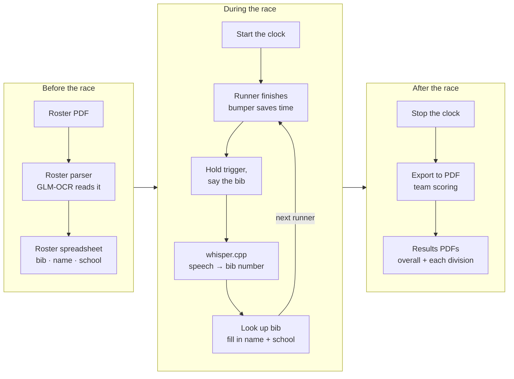

# CrossCountryTimer


The cross country timer app built with rayGui

---

## Workflow



---

## Build

Requires CMake 3.22+, C23 compiler(gcc 16), and (by default) a C++ compiler for whisper.cpp.

`third_party/raylib`, `third_party/SDL`, `third_party/whisper.cpp`, `third_party/xlsxio`, `third_party/zlib`, and `third_party/expat` are git submodules. After a clone:

```bash
git submodule update --init --recursive
```

Or clone with them already filled in:

```bash
git clone --recurse-submodules https://github.com/chimbiwide/CrossCountryTimer.git
```

.xlsx reading and writing is built in from xlsxio. zlib, minizip, and expat are compiled with the app and linked statically.

raylib runs on its SDL3 backend, which is what makes gamepad rumble work. SDL3 (`third_party/SDL`) is compiled with the app and linked statically.

On Debian/Ubuntu, raylib and SDL also need X11, OpenGL, and udev headers:

```bash
sudo apt install build-essential cmake git \
    libgl1-mesa-dev libx11-dev libxcursor-dev libxinerama-dev \
    libxrandr-dev libxi-dev libxext-dev libxfixes-dev libasound2-dev \
    libudev-dev
```

On Fedora:

```bash
sudo dnf install gcc gcc-c++ cmake git \
    mesa-libGL-devel libX11-devel libXcursor-devel libXinerama-devel \
    libXrandr-devel libXi-devel libXext-devel libXfixes-devel alsa-lib-devel \
    systemd-devel
```

Configure and compile from the repo root:

```bash
cmake -S . -B build
cmake --build build
```

The binary lands at `build/CrossCountryTimer`:

```bash
./build/CrossCountryTimer
```

Run it from the repo root so it can find `data/Google-Sans-Mono-Regular.ttf`.

### Windows (MinGW)

Needs CMake 3.22+, MinGW gcc/g++, and `mingw32-make` on `PATH`. There is no Visual Studio project. A plain `cmake -S . -B build` picks NMake and stops, because that generator wants the Visual Studio compiler.

From the repo root, in PowerShell:

```powershell
cmake --preset windows
cmake --build --preset windows -j
```

The preset is a Release build and writes `build\CrossCountryTimer.exe`. Start it from the repo root:

```powershell
.\build\CrossCountryTimer.exe
```

MinGW's runtime (libgcc, libstdc++, winpthread) is linked into the exe, so it needs no MinGW DLLs on `PATH`.

#### Portable copy

To run the timer and the roster parser on another PC, build both and collect them into one folder:

```powershell
.\package.ps1
```

This writes `dist\CrossCountryTimer\`:

```
CrossCountryTimer.exe
RosterParser.exe
pdfium.dll
data\index.xlsx                  (copied from data\ if it is there)
models\GLM-OCR.Q4_K_M.gguf
models\mmproj-GLM-OCR-Q8_0.gguf
```

Copy the whole folder over and double-click either exe. All paths are relative to the working directory, which is the exe's folder when it is double-clicked. The font and the whisper model are built into `CrossCountryTimer.exe`.

whisper.cpp and llama.cpp are built without `-march=native`, for a fixed AVX2 baseline. The other PC needs an AVX2 CPU: Intel Haswell (2013) / AMD Zen or newer.

Default build type on Linux is Debug. For a Release build:

```bash
cmake -S . -B build -DCMAKE_BUILD_TYPE=Release
cmake --build build
```

The SDL3 backend is the default (`CCT_WITH_SDL=ON`). To build on raylib's GLFW backend instead, which has no gamepad rumble:

```bash
cmake -S . -B build -DCCT_WITH_SDL=OFF
cmake --build build
```

### GLM-OCR model

The roster parser reads roster PDFs with GLM-OCR. It needs two files in `models/`: `GLM-OCR.Q4_K_M.gguf` and its vision part, `mmproj-GLM-OCR-Q8_0.gguf` (about 1 GB together). From the repo root:

```bash
./download-glm-ocr.sh
```

On Windows, in PowerShell:

```powershell
.\download-glm-ocr.ps1
```

If PowerShell blocks the script, run it as `powershell -ExecutionPolicy Bypass -File .\download-glm-ocr.ps1`.

Both scripts skip a file that is already there and check each download against its SHA256.

---

### Division

- Freshman
- Varsity
- JV 
- Middleman

New column for divsion: F, V, J, M

---

### TODO

add the ability to choose mic in the settings panel
